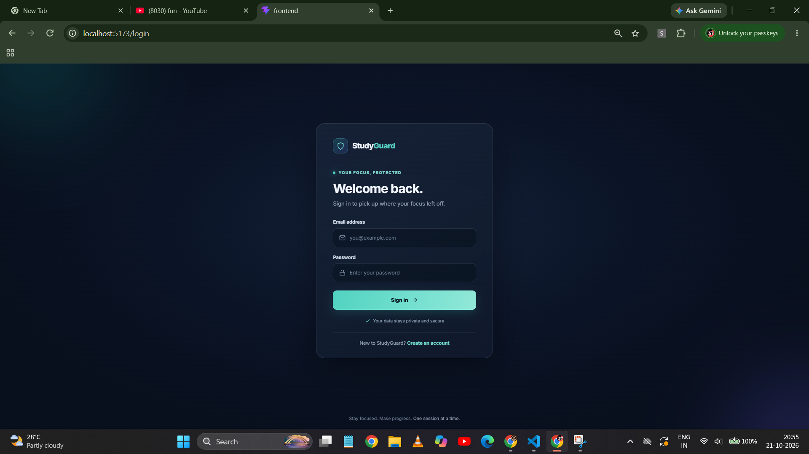
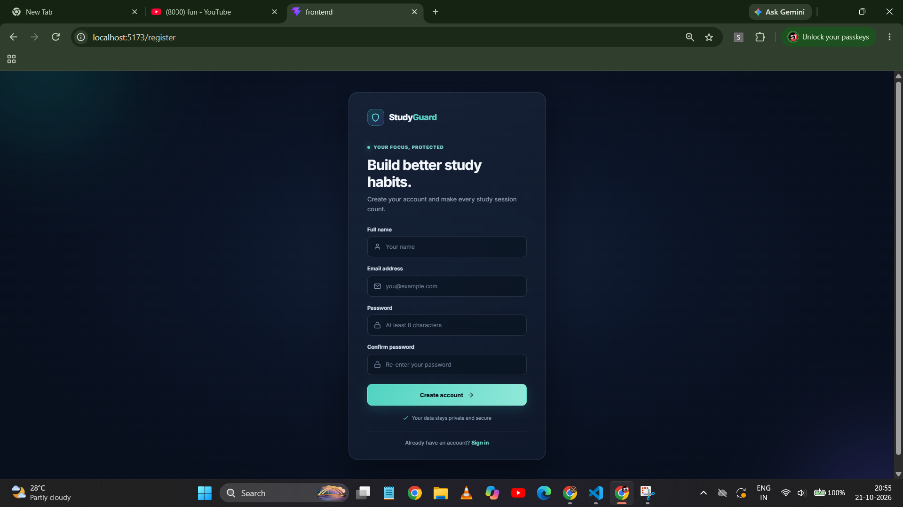

# StudyGuard --- YouTube Study Tracker

> **Stay Focused. Study Smart.**\
> StudyGuard is a productivity-focused web application and Chrome
> extension designed to help students understand their YouTube habits,
> track learning sessions, and reduce distractions while studying.

StudyGuard combines a React dashboard, a Node.js/Express backend, and a
Chrome Extension to bring study tracking and distraction control closer
together. The current version focuses on account access, watch-time
insights, video history, and an initial Study Mode experience. The
project is being developed iteratively, with stronger blocking rules,
analytics, goals, and reporting planned for future versions.

## Screenshots

The screenshots below show the current development build. They
illustrate the interface and observed behavior; some metrics are sample
or locally recorded data and should not be interpreted as benchmark
results.

### 1. Study Mode dashboard


The Study Mode page provides an overview of the current protection
state. It includes distraction-control features such as hiding
recommendations and comments, a protection-status area, blocked-video
count, focus-time metric, and study tips. The displayed status depends
on the current application state and integrations.

### 2. Main dashboard and extension popup


The dashboard summarizes tracked activity with study time, entertainment
time, videos watched, and charts comparing study and entertainment
activity. The extension popup provides quick access to the signed-in
account and controls for Study Mode and watch-time tracking, along with
summary counters and a dashboard shortcut.

### 3. Sign-in page



The sign-in screen lets an existing user access their StudyGuard
account. Authentication is intended to keep each user's tracking history
and settings associated with their own account.

### 4. Account registration page



The registration screen collects a name, email address, password, and
password confirmation. It is the entry point for new users. Passwords
should be stored as secure hashes on the backend, never as plain text.

### 5. YouTube search results before Study Mode is enabled


This screenshot captures a YouTube search for gaming content before
Study Mode is enabled. It serves as a visual baseline for comparing the
page with Study Mode turned on.

### 6. Extension popup with Study Mode turned off


The popup shows Study Mode switched off while the user is browsing
YouTube. The extension exposes its controls in one place so the user can
enable or disable protection without opening the dashboard.

### 7. YouTube search results with Study Mode enabled


With Study Mode enabled, the gaming search results shown here have
blurred thumbnails and reduced visual emphasis. This demonstrates the
current distraction-reduction behavior. The long-term goal is to enforce
configurable study rules more consistently, including blocking playback
for content classified as entertainment.

## Current features

### Chrome Extension

-   Provides a popup for account status and quick controls.
-   Offers Study Mode and watch-time tracking toggles.
-   Applies distraction-reduction behavior on YouTube when Study Mode is
    enabled.
-   Communicates extension state to YouTube tabs so page behavior can
    respond to toggle changes.
-   Displays quick study and entertainment time summaries.

### Web dashboard

-   React-based dashboard with a dark interface.
-   Summary cards for study time, entertainment time, and videos
    watched.
-   Charts for comparing study versus entertainment activity and
    reviewing study trends.
-   Video history and analytics sections.
-   Study Mode page with protection status and study tips.
-   Sign-in and registration pages.

### Backend

-   Node.js and Express REST API.
-   MongoDB/Mongoose integration for persistent application data.
-   Authentication endpoints and protected user-specific routes.
-   Video tracking and analytics API areas.
-   Shared video classification logic used by analytics to calculate
    subject/category insights.

> **Development note:** Feature availability depends on the current
> local setup and integration state. This README describes the current
> project direction and visible behavior, not a claim that every planned
> feature is complete or production-hardened.

## Technology stack

  -----------------------------------------------------------------------
  Area                                Technologies
  ----------------------------------- -----------------------------------
  Frontend                            React, Vite, JavaScript, CSS

  Backend                             Node.js, Express.js

  Database                            MongoDB Atlas, Mongoose

  Browser integration                 Chrome Extension, Manifest V3

  Visualization                       Recharts

  Authentication                      Password hashing and token-based
                                      authentication (backend
                                      implementation)
  -----------------------------------------------------------------------

## How it works

1.  The user signs in to StudyGuard through the web application or
    extension popup.
2.  The extension observes supported YouTube activity and, when tracking
    is enabled, collects video-session information.
3.  Video records are sent to the backend API and associated with the
    authenticated user where the relevant integration is enabled.
4.  The dashboard requests summary and analytics data from the backend.
5.  When Study Mode is enabled, the extension communicates the setting
    to YouTube tabs and applies supported page-level distraction
    controls.

Watch-time accuracy and enforcement can be affected by browser lifecycle
events, YouTube's single-page navigation, tab state, network
connectivity, and extension permissions. These areas will continue to be
tested and improved.

## Getting started

### Prerequisites

-   Node.js and npm
-   A MongoDB Atlas cluster or another supported MongoDB connection
-   Google Chrome
-   Git

### 1. Clone the repository

``` bash
git clone <YOUR_GITHUB_REPOSITORY_URL>
cd StudyGuard
```

Replace `<YOUR_GITHUB_REPOSITORY_URL>` with the URL of your GitHub
repository.

### 2. Configure the backend

``` bash
cd backend
npm install
```

Create a `backend/.env` file using the variable names expected by your
backend configuration. For example:

``` env
PORT=3000
MONGODB_URI=your_mongodb_connection_string
JWT_SECRET=replace_with_a_long_random_secret
```

Use the actual environment variable names required by the project code.
Never commit `.env`, database credentials, or real secrets to GitHub.

Start the backend in development mode:

``` bash
npm run dev
```

### 3. Start the frontend

Open a second terminal from the repository root:

``` bash
cd frontend
npm install
npm run dev
```

Vite will print the local URL, commonly `http://localhost:5173`.

### 4. Load the Chrome Extension

1.  Open `chrome://extensions` in Chrome.
2.  Turn on **Developer mode**.
3.  Select **Load unpacked**.
4.  Choose the project's `extension` directory (the directory containing
    `manifest.json`).
5.  Open YouTube and pin the StudyGuard extension if desired.

Keep the backend and frontend running while testing integrations that
depend on them. Exact commands or environment variables may differ if
the repository structure has changed.

## Repository structure

``` text
StudyGuard/
├── backend/       # Express API, database connection, models, routes, services
├── frontend/      # React/Vite dashboard and authentication screens
├── extension/     # Chrome Extension popup, scripts, styles, manifest
├── assets/
│   └── screenshots/
└── README.md
```

This is a high-level overview; the exact subfolders and filenames may
evolve as the project grows.

## Roadmap --- next version

The next version will focus on making StudyGuard more reliable,
configurable, and useful for daily study routines.

### Study Mode improvements

-   Classify videos using configurable keywords, channels, and user
    preferences.
-   Block playback of entertainment videos with a clear explanation to
    the user.
-   Improve thumbnail blurring and hiding of entertainment
    recommendations.
-   Hide YouTube Shorts, comments, homepage distractions, and other
    configurable page elements.
-   Handle YouTube navigation and dynamically loaded content more
    reliably.
-   Add clear status feedback when a video is blocked and why.

### Tracking reliability

-   Improve play/pause and video-change detection.
-   Prevent duplicate records and save one finalized session record per
    video session.
-   Handle refreshes, tab closure, browser shutdown, and interrupted
    sessions more reliably.
-   Track only when the user has enabled tracking and make the current
    tracking state visible.

### Analytics and goals

-   Daily, weekly, and monthly study summaries.
-   Study streaks, longest streak, average daily study time, and total
    learning hours.
-   Most-watched subjects and channels, productive days/hours, and
    study-versus-entertainment percentages.
-   Pie, bar, and line charts with date filters.
-   Daily and weekly goals, including study-time targets and
    educational-video targets.
-   Automatic progress updates as sessions are recorded.

### Focus tools and notifications

-   Configurable study schedules and Focus Mode.
-   Study reminders, break reminders, and daily-goal completion
    notifications.
-   User-configurable allowed study keywords, blocked keywords, allowed
    channels, and blocked channels.
-   Settings synchronized between the dashboard and extension.

### Reports and data management

-   Weekly productivity reports and a transparent productivity-score
    calculation.
-   CSV export and PDF report download.
-   Optional email delivery of reports.
-   Search, date/category filters, and history management.

### Product readiness

-   Complete and test authentication flows, including logout and session
    persistence.
-   Add robust validation, consistent API errors, and security checks.
-   Migrate and validate persistent user data with MongoDB Atlas.
-   Add automated tests for tracking, authentication, analytics, and
    Study Mode.
-   Improve accessibility, responsive layouts, onboarding, and
    user-facing error messages.
-   Prepare deployment for the frontend, backend, and eventual Chrome
    Web Store publication.

These are planned improvements, not promises that every item will be
included in the very next release.

## Privacy and security

StudyGuard is intended to handle personal viewing and study-activity
data responsibly.

-   Keep credentials and secrets in environment variables.
-   Do not commit `.env` files or tokens.
-   Restrict API access to authenticated users where appropriate.
-   Store password hashes rather than plain-text passwords.
-   Clearly communicate what activity is tracked and provide user
    controls for tracking.
-   Before public release, document data retention, deletion, and
    privacy practices.

## Current status

StudyGuard is an actively developed project. The current build
demonstrates the dashboard, account screens, extension controls, initial
Study Mode page effects, and the planned integration between the browser
extension and backend. Further work is required to validate end-to-end
behavior across browser restarts, edge cases, and a production
deployment.

## Contributing

Suggestions and bug reports are welcome. When reporting a bug, include
the steps to reproduce it, the expected behavior, the actual behavior,
and relevant console/server errors. Never include passwords, JWTs, or
database connection strings in an issue.

## License

A license has not yet been specified. Add a `LICENSE` file before
presenting the repository as open source; without one, standard
copyright restrictions still apply.
